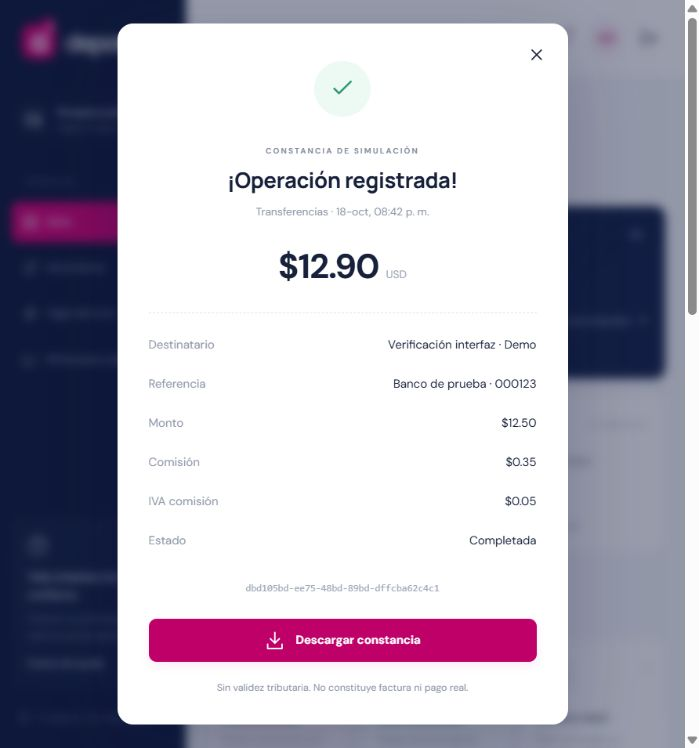

# Verificación de la entrega

Verificación realizada el 20 de octubre de 2026 (fecha local de Ecuador continental).

## Resultados

- `dotnet build`: compilación de .NET 10 correcta, sin errores ni advertencias.
- `npm run build -- --configuration production` desde `frontend`: build de producción de Angular 21 correcto; visor PDF.js se carga de forma diferida.
- `node tests/integration.mjs`: 18 grupos aprobados contra una instancia real de PostgreSQL 18, con una API y base temporales independientes de la demo. Cubre módulo 10 de cédula, cargo fijo solicitado e IVA, prevención de tipos fuera de alcance, acreditaciones pendientes, cifrado de códigos móviles, aprobación Deuna y carga/servicio de QR.
- `npm audit`: cero vulnerabilidades reportadas para el árbol de dependencias de frontend después de actualizar PDF.js.
- Docker limpio (`docker compose -p deporet-clean-test up -d --build`): build multi-etapa correcto y PostgreSQL, API y Nginx saludables. `node tests/docker-smoke.mjs deporet-clean-test 8091` confirmó inicio de sesión, generación y descarga del PDF en Linux, procesamiento de avatar y CSS de producción.
- `docker compose up -d --build` reconstruyó y levantó API y frontend sin eliminar volúmenes. Se aplicó `OperatorReviewAccess` sobre la base persistente; `/api/health` y la página respondieron HTTP 200. Los chunks principales, de transacciones y de acreditación respondieron HTTP 200, los chunks inexistentes HTTP 404 y `index.html` conserva `Cache-Control: no-cache`.
- Las rutas Angular ahora sirven páginas dedicadas para transferencias, giros, recargas, Efectivo Móvil, Deuna y Equifax. La bandeja de revisión y la configuración Equifax se muestran por permiso; el entorno Equifax solo contempla Sandbox o Producción.
- Docker principal permanece disponible en `http://localhost:8088`; se preservaron los volúmenes de PostgreSQL y claves.

## Cobertura de integración

La suite cubre autorización basada en datos, cartera de ejecutivos, cálculo fiscal, SignalR, idempotencia, liquidación y reservas concurrentes, aprobaciones, recargas, consulta de crédito de demostración y consentimiento, reportes PDF protegidos por titular, descargas, configuración de proveedores, avatar y perfil, invalidación de sesiones, prevención de sobregiros y conciliación de partida doble.

## Límites de verificación

Las operaciones financieras, el proveedor de pagos y la respuesta Equifax se prueban en modo sandbox; no se probó movimiento de fondos, consulta a Equifax, emisión SRI ni conexión a un proveedor externo real. El PDF es demostrativo y no es un informe oficial de Equifax. La verificación visual no sustituye una matriz completa de dispositivos, auditoría de accesibilidad, pruebas de carga o evaluación de seguridad.

